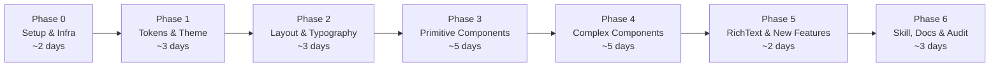

# VLRC → Astryx Migration Plan

> [!IMPORTANT]
> This is a **full architectural migration** of `@vlrc-fe/components` (v2.8.0) and `@vlrc-fe/hooks` (v1.2.0) to Meta's **Astryx Design System** (`@astryxdesign/core`, `@astryxdesign/cli`, `@astryxdesign/richtext`). VLRC components are **built on top of Astryx** — wrapping and extending Astryx primitives with VLRC-specific features (editable, copyable, rich typography, etc.), not replacing them. All components must use **design tokens exclusively** — zero magic CSS values, zero magic numbers, zero magic strings.

> [!NOTE]
> **Astryx Documentation**: [Docs](https://astryx.atmeta.com/docs/working-with-ai) · [Tokens](https://astryx.atmeta.com/docs/tokens) · [Components](https://astryx.atmeta.com/components) · [Theme](https://astryx.atmeta.com/docs/theme) · [Migration](https://astryx.atmeta.com/docs/migration) · [Authoring](https://astryx.atmeta.com/docs/authoring) · [GitHub](https://github.com/meta/astryx)
>
> Astryx components already have comprehensive testing. VLRC tests should focus on **VLRC-specific features and wrappers only** — don't re-test what Astryx already covers.

---

## Table of Contents

1. [Current State Summary](#1-current-state-summary)
2. [Target State Summary](#2-target-state-summary)
3. [Token Mapping Reference](#3-token-mapping-reference)
4. [Component Migration Matrix](#4-component-migration-matrix)
5. [Migration Phases](#5-migration-phases)
6. [Skill & Documentation Setup](#6-skill--documentation-setup)
7. [Risk Register & Mitigations](#7-risk-register--mitigations)
8. [Estimated Scope](#8-estimated-scope)

---

## 1. Current State Summary

### Architecture

| Dimension      | Current (`@vlrc-fe/components`)                                              |
| -------------- | ---------------------------------------------------------------------------- |
| **Styling**    | Meta StyleX 0.19.1 via `@stylexjs/unplugin`                                  |
| **Tokens**     | Hand-authored `tokens.stylex.ts` → CSS custom properties                     |
| **Themes**     | 4 themes in `theme.css` (light, dark, pink, lavender)                        |
| **Typography** | `Text`, `Title`, `Paragraph`, `Link`, `Blockquote`, `Code` (7-tier: xxs–xxl) |
| **Layout**     | `Flex`, `Grid`, `Row/Col` (24-column), `useBreakpoint`                       |
| **Spacing**    | 7-tier named scale: xxs(4px)–xxl(48px)                                       |
| **Components** | 71+ UI primitives + DataTable, Form system, Modal system                     |
| **Icons**      | Central registry (~120 Lucide icons)                                         |
| **Build**      | Vite lib mode + tsc declarations, React Compiler                             |
| **Testing**    | Vitest 5.x, Storybook 10.x                                                   |
| **Utility**    | `cn()` (clsx + twMerge legacy), `sx()` (stylex.props wrapper)                |

### Token Scale Summary

```
Spacing:  xxs=4px, xs=8px, sm=12px, md=16px, lg=24px, xl=32px, xxl=48px
Radii:    none=0, sm=calc(r-4), md=calc(r-2), lg=r, xl=calc(r+4), 2xl=calc(r+8), full=9999px
Colors:   23 semantic tokens (bg/fg/primary/secondary/muted/accent/destructive/border/ring/chart/sidebar)
Text:     xxs=8px, xs=10px, sm=12px, md=14px, lg=16px, xl=20px, xxl=24px
Title:    xxs=10px, xs=12px, sm=14px, md=16px, lg=20px, xl=24px, xxl=32px
```

---

## 2. Target State Summary

### Architecture

| Dimension      | Target (Astryx)                                                                                                             |
| -------------- | --------------------------------------------------------------------------------------------------------------------------- |
| **Styling**    | StyleX internals, precompiled CSS for consumers (`astryx.css`)                                                              |
| **Tokens**     | `@astryxdesign/core/tokens.stylex` + CSS custom properties                                                                  |
| **Themes**     | CSS `@layer astryx-theme` overrides, 7 pre-built themes                                                                     |
| **Typography** | Semantic ramps: `caption`, `body-sm`, `body`, `body-lg`, `subtitle`, `title-sm`, `title`, `title-lg`, `headline`, `display` |
| **Layout**     | `Box`, `Stack`, `HStack`, `VStack`, `Flex`, `Grid`, `Container`, `Center`, `Divider`                                        |
| **Spacing**    | Numeric 4px grid: `0`–`96` (38 steps)                                                                                       |
| **Components** | 80+ components with uniform `size`/`variant`/`tone` props                                                                   |
| **Icons**      | Theme-driven `IconProvider` registry (Lucide/Phosphor/Heroicons)                                                            |
| **Build**      | `@astryxdesign/build` (Vite/Next.js), CSS layer prefix splitting                                                            |
| **CLI**        | `@astryxdesign/cli` — component inspection, swizzle, templates, codemods, audit                                             |
| **RichText**   | `@astryxdesign/richtext` — Lexical-based editor + headless Markdown serializers                                             |

### Astryx Token Scale Summary

```
Spacing:  0=0, 0.5=2px, 1=4px, 1.5=6px, 2=8px, 2.5=10px, 3=12px, 4=16px, 5=20px, 6=24px, 8=32px, 12=48px, ...up to 96=384px
Radii:    none=0, sm=2px, default=4px, md=6px, lg=8px, xl=12px, 2xl=16px, 3xl=24px, full=9999px
Colors:   Semantic surfaces (surface-*), foregrounds (fg-*), borders (border-*), interactive states, 12 dataviz categoricals
Typography: caption=12/16, body-sm=14/20, body=16/24, body-lg=18/28, subtitle=20/28, title-sm=24/32, title=30/36, title-lg=36/40, headline=48/1, display=60/1
Weights:  regular=400, medium=500, semibold=600, bold=700
```

---

## 3. Token Mapping Reference

### 3.1 Spacing Scale

| VLRC Token | px   | → Astryx Token | px   | Notes    |
| ---------- | ---- | -------------- | ---- | -------- |
| `xxs`      | 4px  | `1`            | 4px  | ✅ Exact |
| `xs`       | 8px  | `2`            | 8px  | ✅ Exact |
| `sm`       | 12px | `3`            | 12px | ✅ Exact |
| `md`       | 16px | `4`            | 16px | ✅ Exact |
| `lg`       | 24px | `6`            | 24px | ✅ Exact |
| `xl`       | 32px | `8`            | 32px | ✅ Exact |
| `xxl`      | 48px | `12`           | 48px | ✅ Exact |

> [!TIP]
> All 7 VLRC spacing tiers map exactly to Astryx numeric tokens. The migration is lossless. Astryx additionally provides finer granularity (0.5, 1.5, 2.5, 3.5, 5, 7, 9, 10, 11, etc.) for future use.

### 3.2 Typography Ramp

| VLRC `Text` Size | px   | → Astryx Ramp            | px   | Notes                                           |
| ---------------- | ---- | ------------------------ | ---- | ----------------------------------------------- |
| `xxs` (8px)      | 8px  | Custom `--font-size-xxs` | 8px  | ✅ Preserved via `@layer astryx-theme` override |
| `xs` (10px)      | 10px | Custom `--font-size-xs`  | 10px | ✅ Preserved via `@layer astryx-theme` override |
| `sm` (12px)      | 12px | `caption`                | 12px | ✅ Exact                                        |
| `md` (14px)      | 14px | `body-sm`                | 14px | ✅ Exact                                        |
| `lg` (16px)      | 16px | `body`                   | 16px | ✅ Exact                                        |
| `xl` (20px)      | 20px | `subtitle`               | 20px | ✅ Exact                                        |
| `xxl` (24px)     | 24px | `title-sm`               | 24px | ✅ Exact                                        |

| VLRC `Title` Size | px   | → Astryx Ramp                  | px   | Notes                                           |
| ----------------- | ---- | ------------------------------ | ---- | ----------------------------------------------- |
| `xxs` (10px)      | 10px | Custom `--font-size-title-xxs` | 10px | ✅ Preserved via `@layer astryx-theme` override |
| `xs` (12px)       | 12px | `caption`                      | 12px | ✅ Exact                                        |
| `sm` (14px)       | 14px | `body-sm`                      | 14px | ✅ Exact                                        |
| `md` (16px)       | 16px | `body`                         | 16px | ✅ Exact                                        |
| `lg` (20px)       | 20px | `subtitle`                     | 20px | ✅ Exact                                        |
| `xl` (24px)       | 24px | `title-sm`                     | 24px | ✅ Exact                                        |
| `xxl` (32px)      | 32px | Custom `--font-size-title-xxl` | 32px | ✅ Preserved via `@layer astryx-theme` override |

> [!TIP]
> Small font sizes (8px, 10px) and Title xxl (32px) are **preserved as custom tokens** defined in `@layer astryx-theme`. These extend Astryx's built-in ramp without conflicting. All typography must reference tokens — no hardcoded `font-size` values anywhere in component source.

### 3.3 Color & Unified Token System (Zero Magic Values)

> [!IMPORTANT]
> **Unified Token Contract**: All Astryx tokens and VLRC tokens are merged into a single cohesive token contract.
> **ZERO MAGIC CSS / NUMBERS / STRINGS**: Every color, surface, border, spacing, font size, line height, shadow, and radius in any component MUST reference a design token from `@vlrc-fe/components/theme` or CSS variable. Hardcoded hex codes (`#...`), arbitrary pixel numbers (`13px`, `22px`), and arbitrary box shadows are strictly forbidden and will be caught via automated lint/audit scripts.

| VLRC Token                     | → Astryx Merged Token                              | CSS Custom Property                |
| ------------------------------ | -------------------------------------------------- | ---------------------------------- |
| `colors.background`            | `color.surfaceDefault`                             | `--color-surface-default`          |
| `colors.foreground`            | `color.fgDefault`                                  | `--color-fg-default`               |
| `colors.card`                  | `color.surfaceRaised`                              | `--color-surface-raised`           |
| `colors.cardForeground`        | `color.fgDefault`                                  | `--color-fg-default`               |
| `colors.popover`               | `color.surfaceOverlay`                             | `--color-surface-overlay`          |
| `colors.popoverForeground`     | `color.fgDefault`                                  | `--color-fg-default`               |
| `colors.primary`               | `color.surfaceAccent` / `color.interactiveDefault` | `--color-surface-accent`           |
| `colors.primaryForeground`     | `color.fgInverse`                                  | `--color-fg-inverse`               |
| `colors.secondary`             | `color.surfaceSubtle`                              | `--color-surface-subtle`           |
| `colors.secondaryForeground`   | `color.fgDefault`                                  | `--color-fg-default`               |
| `colors.muted`                 | `color.surfaceMuted`                               | `--color-surface-muted`            |
| `colors.mutedForeground`       | `color.fgMuted`                                    | `--color-fg-muted`                 |
| `colors.accent`                | `color.surfaceAccentSubtle`                        | `--color-surface-accent-subtle`    |
| `colors.accentForeground`      | `color.fgAccent`                                   | `--color-fg-accent`                |
| `colors.destructive`           | `color.surfaceDanger`                              | `--color-surface-danger`           |
| `colors.destructiveForeground` | `color.fgInverse`                                  | `--color-fg-inverse`               |
| `colors.border`                | `color.borderDefault`                              | `--color-border-default`           |
| `colors.input`                 | `color.borderMuted`                                | `--color-border-muted`             |
| `colors.ring`                  | `color.focusRing`                                  | `--color-focus-ring`               |
| `colors.chart1–5`              | `color.datavizCategorical1–12`                     | `--color-dataviz-categorical-1–12` |
| `textColors.default`           | `color.fgDefault`                                  | `--color-fg-default`               |
| `textColors.muted`             | `color.fgMuted`                                    | `--color-fg-muted`                 |
| `textColors.primary`           | `color.fgAccent`                                   | `--color-fg-accent`                |
| `textColors.destructive`       | `color.fgDanger`                                   | `--color-fg-danger`                |

### 3.4 Border Radius Mapping

> [!IMPORTANT]
> **Rename `radii` → `radius`** across the entire codebase. Follow Astryx's smaller default radius values (default=4px) — do NOT preserve VLRC's oversized 16px base.

| VLRC Token (old `radii`) | Old Value          | → Astryx Token (`radius`)             | New Value |
| ------------------------ | ------------------ | ------------------------------------- | --------- |
| `radii.none`             | 0px                | `radius.none` / `--radius-none`       | 0px       |
| `radii.sm`               | calc(r-4px) ≈ 12px | `radius.sm` / `--radius-sm`           | 2px       |
| `radii.md`               | calc(r-2px) ≈ 14px | `radius.default` / `--radius-default` | 4px       |
| `radii.lg`               | r = 16px           | `radius.md` / `--radius-md`           | 6px       |
| `radii.xl`               | calc(r+4px) ≈ 20px | `radius.lg` / `--radius-lg`           | 8px       |
| `radii.2xl`              | calc(r+8px) ≈ 24px | `radius.xl` / `--radius-xl`           | 12px      |
| `radii.full`             | 9999px             | `radius.full` / `--radius-full`       | 9999px    |
| — (new)                  | —                  | `radius.2xl` / `--radius-2xl`         | 16px      |
| — (new)                  | —                  | `radius.3xl` / `--radius-3xl`         | 24px      |

> [!NOTE]
> VLRC's old radius scale was unusually large (base 16px). Adopting Astryx's standard scale (default=4px) brings the library in line with modern design system conventions. All components will be updated to use the new `radius.*` tokens.

### 3.5 Shadow & Elevation (Astryx Standard & Box-Shadow Audit)

> [!IMPORTANT]
> **Follow Astryx Shadow Scale & Audit Box-Shadows**:
> All components with hardcoded CSS `box-shadow` (modals, popovers, dropdowns, cards, tooltips, buttons) will be audited and converted to standard Astryx shadow tokens. No ad-hoc `box-shadow: 0 4px 6px ...` strings in the entire codebase.

Astryx provides 8 elevation tiers:

| Token Name     | CSS Custom Property | Intended Use                             |
| -------------- | ------------------- | ---------------------------------------- |
| `shadow.none`  | `--shadow-none`     | Reset / flat elements                    |
| `shadow.xs`    | `--shadow-xs`       | Subtle borders, interactive buttons      |
| `shadow.sm`    | `--shadow-sm`       | Cards, badge elevated states             |
| `shadow.md`    | `--shadow-md`       | Floating panels, dropdown menus          |
| `shadow.lg`    | `--shadow-lg`       | Modals, drawers, popovers                |
| `shadow.xl`    | `--shadow-xl`       | High elevation dialogs, preview overlays |
| `shadow.2xl`   | `--shadow-2xl`      | Critical alerts, maximized modals        |
| `shadow.inner` | `--shadow-inner`    | Well states, inset inputs                |

---

### 3.6 Motion Tokens (Astryx Standard)

Replace ad-hoc animation timings and CSS transitions with Astryx motion tokens:

```
Durations:
- duration.fast    (--duration-fast):   100ms
- duration.normal  (--duration-normal): 200ms
- duration.slow    (--duration-slow):   300ms
- duration.slower  (--duration-slower): 500ms

Easings:
- easing.standard    (--easing-standard)
- easing.decelerate  (--easing-decelerate)
- easing.accelerate  (--easing-accelerate)
- easing.linear      (--easing-linear)
```

---

## 4. Component Migration Matrix

> [!NOTE]
> **Component Strategy: Wrapper & Extension Architecture**
> VLRC components are built **on top of Astryx primitives**, not simply discarded. VLRC components pack significant proprietary enhancements:
>
> - Typography has `editable`, `copyable`, dynamic tooltip truncation, line-clamp, margin shorthand helpers, and custom mono/gradient variants.
> - Form components bind to `react-hook-form` and `FormBase` contextual validation.
> - Layout retains responsive breakpoint awareness and custom token gap resolution.
>
> Astryx powers the underlying engine, a11y primitives, and baseline styling, while VLRC layers the ergonomic features on top.

### 4.1 UI Primitives (Built on Astryx)

| #   | VLRC Component         | Astryx Foundation               | Strategy         | Notes                                            |
| --- | ---------------------- | ------------------------------- | ---------------- | ------------------------------------------------ |
| 1   | `Button`               | Astryx `Button` / `IconButton`  | Wrapper          | Retain VLRC icon slots, loading states, sx prop  |
| 2   | `Badge`                | Astryx `Badge` / `Tag`          | Wrapper          | Map tone/variant, retain overflow badge behavior |
| 3   | `Checkbox`             | Astryx `Checkbox`               | Wrapper          | Form integration, custom description slots       |
| 4   | `Input`                | Astryx `TextInput`              | Wrapper          | Add prefix/suffix addons, clearable action       |
| 5   | `Textarea`             | Astryx `TextArea`               | Wrapper          | Auto-resize support, counter display             |
| 6   | `Select`               | Astryx `Select`                 | Wrapper          | Custom option renderers, search filter           |
| 7   | `Switch`               | Astryx `Switch`                 | Wrapper          | Retain custom labels & sizes                     |
| 8   | `Slider`               | Astryx `Slider`                 | Wrapper          | Range and marks support                          |
| 9   | `Radio` / `RadioGroup` | Astryx `Radio` / `RadioGroup`   | Wrapper          | Retain card radio variants                       |
| 10  | `Tooltip`              | Astryx `Tooltip`                | Wrapper          | Retain custom delays, arrow rendering            |
| 11  | `Popover`              | Astryx `Popover`                | Wrapper          | Focus management, trigger bindings               |
| 12  | `Dialog`               | Astryx `Modal` / `Dialog`       | Wrapper          | Retain responsive modal scaling                  |
| 13  | `AlertDialog`          | Astryx `AlertDialog`            | Wrapper          | Preset destructive / confirmation styles         |
| 14  | `Alert`                | Astryx `Alert`                  | Wrapper          | Custom banner layouts & close actions            |
| 15  | `Accordion`            | Astryx `Accordion`              | Wrapper          | Custom chevron icons and expand states           |
| 16  | `Avatar`               | Astryx `Avatar` / `AvatarGroup` | Wrapper          | Fallback initials, status indicators             |
| 17  | `Card`                 | Astryx `Card`                   | Wrapper          | Header, footer, action slots                     |
| 18  | `Tabs`                 | Astryx `Tabs`                   | Wrapper          | Segmented variants, scrollable tab list          |
| 19  | `Breadcrumb`           | Astryx `Breadcrumb`             | Wrapper          | Custom separator icons, collapsed items          |
| 20  | `Pagination`           | Astryx `Pagination`             | Wrapper          | Page jumper, page size selector                  |
| 21  | `Progress`             | Astryx `ProgressBar`            | Wrapper          | Striped, animated, percentage display            |
| 22  | `Skeleton`             | Astryx `Skeleton`               | Wrapper          | Custom preset shapes (avatar, text, card)        |
| 23  | `Separator`            | Astryx `Divider`                | Direct / Wrapper | Horizontal / vertical orientations               |
| 24  | `DropdownMenu`         | Astryx `DropdownMenu`           | Wrapper          | Sub-menus, checkbox items, radio items           |
| 25  | `ContextMenu`          | Astryx `ContextMenu`            | Wrapper          | Trigger binding, custom item shortcuts           |
| 26  | `Calendar`             | Astryx `DatePicker`             | Wrapper          | Range selection, presets, locale support         |
| 27  | `InputOTP`             | Astryx `PinInput`               | Wrapper          | Auto-focus, masked mode                          |
| 28  | `ScrollArea`           | Custom / Radix                  | Restyle          | Style with Astryx scrollbar tokens               |
| 29  | `Spinner`              | Astryx `Spinner`                | Wrapper          | Size presets, brand accent coloring              |
| 30  | `Sonner (Toast)`       | Astryx `Toast`                  | Wrapper          | Toast hook integration (`toast()`)               |
| 31  | `Sheet` / `Drawer`     | Astryx `Drawer`                 | Wrapper          | Placement (top, right, bottom, left)             |
| 32  | `AspectRatio`          | Astryx `AspectRatio`            | Wrapper          | Responsive aspect ratios                         |
| 33  | `Stepper`              | Astryx `Stepper`                | Wrapper          | Step validation, vertical/horizontal             |
| 34  | `Timeline`             | Astryx `Timeline`               | Wrapper          | Custom icons, pending state                      |
| 35  | `Empty`                | Astryx `EmptyState`             | Wrapper          | Preset illustrations, action buttons             |
| 36  | `Stat`                 | Astryx `Stat` / `MetricCard`    | Wrapper          | Trend indicators, comparison labels              |

### 4.2 Layout Primitives (Preserving Row & Col)

> [!IMPORTANT]
> **Keep `<Row>` & `<Col>`! Astryx `Grid` replaces `<Grid>` only.**
>
> - `<Row>` and `<Col>` provide the 24-column flex grid with responsive breakpoints (`xs`, `sm`, `md`, `lg`, `xl`, `xxl`), offsets, push/pull, and gutter contexts. **They are kept** and refactored to consume Astryx unified spacing and gutter tokens.
> - Current `<Grid>` is replaced/wrapped by Astryx `Grid` for native CSS Grid layouts.
> - New primitives introduced from Astryx: `<Box>`, `<Stack>`, `<HStack>`, `<VStack>`, `<Container>`, `<Center>`.

| Primitive                     | Origin        | Implementation Strategy                                                              |
| ----------------------------- | ------------- | ------------------------------------------------------------------------------------ |
| `Row`                         | VLRC (Keep)   | Refactor internals to use Astryx spacing/gap tokens; preserve 24-col gutter context  |
| `Col`                         | VLRC (Keep)   | Preserve span (0-24), offset, order, responsive breakpoint props                     |
| `Grid`                        | Astryx        | Replaces custom `Grid` with Astryx CSS Grid engine                                   |
| `Flex`                        | VLRC / Astryx | Wraps Astryx `Flex` (with `HStack` / `VStack` fast-paths); preserves 7-tier gap prop |
| `Box`                         | Astryx (New)  | Generic polymorphic container with StyleX & Astryx token support                     |
| `Stack` / `HStack` / `VStack` | Astryx (New)  | High-performance horizontal/vertical layout primitives                               |
| `Container`                   | Astryx (New)  | Centered layout container with responsive max-widths                                 |
| `Center`                      | Astryx (New)  | Centering utility component                                                          |

### 4.3 Typography System (Built on Top of Astryx)

VLRC's typography components (`Text`, `Title`, `Paragraph`, `Link`, `Blockquote`, `Code`) provide rich interactive functionality that will be maintained by wrapping Astryx typography tokens and primitives:

1. **`Text` (Wrapper)**:
   - Built with Astryx text styling and typography tokens.
   - Preserves: `editable` (inline editing), `copyable` (one-click copy with tooltip), `ellipsis` (with automatic tooltip if text overflows), `lines`/`rows` multi-line clamp, margin utilities (`m`, `mt`, `mb`, etc.), keyboard formatting (`kbd`), and semantic types (`secondary`, `muted`, `success`, `danger`, `warning`, `info`).
   - Supports full size scale: `xxs` (8px via custom token), `xs` (10px via custom token), `sm` (caption 12px), `md` (body-sm 14px), `lg` (body 16px), `xl` (subtitle 20px), `xxl` (title-sm 24px).
2. **`Title` (Wrapper)**:
   - Built on Astryx heading elements + `title-*` ramps.
   - Preserves: `editable`, `copyable`, `required` asterisk, `mono` and `gradient` variants, tight/normal/wide letter tracking.
   - Heading level mapping preserved: h1→`xxl` (32px via custom token), h2→`xl` (24px), h3→`lg` (20px), h4→`md` (16px), h5→`sm` (14px), h6→`xs` (12px).
3. **`Paragraph` (Wrapper)**:
   - Built on Astryx body text tokens.
   - Preserves: `lead` variant, spacing tiers (`none`, `sm`, `md`, `lg`), text alignment (`left`, `center`, `right`, `justify`).
4. **`Code` / `CodeBlock`**:
   - Inline code wrapped with Astryx inline code styling.
   - Block code mapped to Astryx `CodeBlock` with syntax highlighting and copy actions.
5. **`Link`**:
   - Built on Astryx `LinkButton` / link primitive with support for external icons, underline modes, and routing wrappers.

### 4.4 Complex Component Migration

| VLRC Component                                                          | Strategy                                                                                                   | Complexity |
| ----------------------------------------------------------------------- | ---------------------------------------------------------------------------------------------------------- | ---------- |
| **DataTable** (full system)                                             | Migrate to Astryx `DataTable` (virtualized, sorting, filtering). Verify TanStack Table integration parity. | 🔴 High    |
| **Form System** (FormInput, FormCheckbox, FormSwitch, FormSelect, etc.) | Rebuild Form controls using Astryx inputs + existing form hook integration.                                | 🔴 High    |
| **Modal / ConfirmModal**                                                | Map to Astryx `Modal` / `AlertDialog`                                                                      | 🟡 Medium  |
| **Sidebar**                                                             | Map to Astryx `SideNav` / `AppShell`                                                                       | 🟡 Medium  |
| **MultiSelect**                                                         | Map to Astryx `MultiSelect` / `Combobox`                                                                   | 🟡 Medium  |
| **FileUpload** (+ adapters)                                             | Map to Astryx `FileUpload`                                                                                 | 🟡 Medium  |
| **Editable**                                                            | Keep custom or use Astryx `TextInput` inline mode                                                          | 🟡 Medium  |
| **CopyButton**                                                          | Map to Astryx `CopyButton`                                                                                 | 🟢 Low     |
| **Command** (cmdk)                                                      | Keep custom (no Astryx equivalent) or use `Combobox`                                                       | 🟡 Medium  |
| **Carousel**                                                            | Keep custom (no direct Astryx equivalent)                                                                  | 🟡 Keep    |
| **CompareSlider**                                                       | Keep custom (no Astryx equivalent)                                                                         | 🟡 Keep    |
| **Masonry**                                                             | Keep custom (no Astryx equivalent)                                                                         | 🟡 Keep    |
| **Gauge**                                                               | Map to Astryx `ProgressCircle` or keep                                                                     | 🟡 Medium  |
| **Rating**                                                              | Keep custom (no Astryx equivalent)                                                                         | 🟡 Keep    |
| **Resizable**                                                           | Keep custom (no Astryx equivalent)                                                                         | 🟡 Keep    |
| **Segmented**                                                           | Keep custom or map to Astryx `Tabs` variant                                                                | 🟡 Medium  |
| **TagsInput**                                                           | Keep custom or verify Astryx equivalent                                                                    | 🟡 Medium  |
| **Stat**                                                                | Map to Astryx `Stat` / `MetricCard`                                                                        | 🟢 Low     |

### 4.5 New Capabilities from Astryx (Not in VLRC)

| Component/Feature                              | Benefit                               |
| ---------------------------------------------- | ------------------------------------- |
| `AppShell` / `TopNav` / `SideNav` / `TreeView` | Full application shell layout system  |
| `RichTextEditor` / `RichTextView`              | Lexical-based rich text (new package) |
| `ColorPicker`                                  | Color selection component             |
| `SearchInput`                                  | Dedicated search input                |
| `AutoComplete`                                 | Auto-complete input                   |
| `DescriptionList`                              | Key-value pair display                |
| `EmptyState`                                   | Empty state pattern                   |
| `Banner`                                       | Notification banners                  |
| Shadow tokens (8 levels)                       | Elevation system                      |
| Motion tokens                                  | Animation system                      |
| 12 dataviz categoricals                        | Color-blind accessible chart colors   |
| Syntax highlighting tokens                     | Code block theming                    |
| `@astryxdesign/richtext`                       | Full rich text editing                |

---

## 5. Migration Phases

### Overview



---

### Phase 0: Infrastructure Setup (~2 days)

**Goal**: Install Astryx packages, configure build pipeline, establish CSS layer ordering.

#### 0.1 Install Dependencies

```bash
# Core packages
pnpm add @astryxdesign/core @astryxdesign/cli @astryxdesign/richtext

# Build integration (for Vite + StyleX prefix splitting)
pnpm add -D @astryxdesign/build

# Choose a base theme
pnpm add @astryxdesign/theme-neutral
```

#### 0.2 Initialize Astryx CLI

```bash
npx @astryxdesign/cli init
```

This generates `AGENTS.md` / `CLAUDE.md` with Astryx component guidelines.

#### 0.3 Configure Vite Build (`packages/components/vite.config.ts`)

- Replace `@stylexjs/unplugin` with `@astryxdesign/build/vite` (`astryxStylex()`)
- Enable prefix splitting: library code → `astryx` prefix, consumer code → `x` prefix
- Ensure CSS layer ordering: `@layer reset, astryx-base, astryx-theme, product;`

#### 0.4 Configure Root CSS

```css
/* packages/components/src/theme/theme.css */
@layer reset, astryx-base, astryx-theme, product;

@import '@astryxdesign/core/reset.css' layer(reset);
@import '@astryxdesign/core/astryx.css' layer(astryx-base);
@import '@astryxdesign/theme-neutral/theme.css' layer(astryx-theme);
```

#### 0.5 Package Exports Update

Update `packages/components/package.json` exports to include Astryx CSS files alongside existing exports.

#### 0.6 Storybook Configuration

Update `.storybook/main.ts` to use `@astryxdesign/build` Vite plugin and import Astryx theme CSS in preview.

#### Deliverables

- [x] All Astryx packages installed
- [x] `astryx init` completed
- [x] Vite config updated with prefix splitting
- [x] CSS layer ordering established
- [x] Storybook rendering Astryx styles
- [x] Existing components still render correctly (no regressions)

---

### Phase 1: Token & Theme Migration (~3 days)

**Goal**: Replace VLRC token definitions with Astryx tokens, create a custom VLRC theme layer.

#### 1.1 Create VLRC Custom Theme

Create a custom Astryx theme that maps current VLRC design values into `@layer astryx-theme`, adhering strictly to Astryx's design patterns:

```css
/* packages/components/src/theme/vlrc-theme.css */
@layer astryx-theme {
  :root {
    /* Brand Accent & Semantics */
    --color-surface-default: #ffffff;
    --color-fg-default: #0f172a;
    --color-surface-accent: #3b82f6;
    --color-fg-accent: #3b82f6;
    --color-surface-danger: #ef4444;
    --color-fg-danger: #ef4444;
    --color-border-default: #e2e8f0;
    --color-border-muted: #cbd5e1;
    --color-fg-muted: #64748b;
    --color-surface-muted: #f8fafc;
    --color-surface-subtle: #f1f5f9;
    --color-surface-raised: #ffffff;
    --color-surface-overlay: #ffffff;
    --color-focus-ring: #3b82f6;

    /* Radius Tokens: Following Astryx Standard Scale (default = 4px) */
    --radius-none: 0px;
    --radius-sm: 2px;
    --radius-default: 4px;
    --radius-md: 6px;
    --radius-lg: 8px;
    --radius-xl: 12px;
    --radius-2xl: 16px;
    --radius-3xl: 24px;
    --radius-full: 9999px;

    /* Custom Small Font Sizes & Ramp Extensions */
    --font-size-xxs: 0.5rem; /* 8px */
    --line-height-xxs: 0.75rem; /* 12px */
    --font-size-xs: 0.625rem; /* 10px */
    --line-height-xs: 0.875rem; /* 14px */
    --font-size-title-xxs: 0.625rem; /* 10px */
    --font-size-title-xxl: 2rem; /* 32px */
    --line-height-title-xxl: 2.25rem; /* 36px */

    /* Astryx Shadow Elevation Tokens */
    --shadow-none: none;
    --shadow-xs: 0 1px 2px 0 rgba(0, 0, 0, 0.05);
    --shadow-sm: 0 1px 3px 0 rgba(0, 0, 0, 0.1), 0 1px 2px -1px rgba(0, 0, 0, 0.1);
    --shadow-md: 0 4px 6px -1px rgba(0, 0, 0, 0.1), 0 2px 4px -2px rgba(0, 0, 0, 0.1);
    --shadow-lg: 0 10px 15px -3px rgba(0, 0, 0, 0.1), 0 4px 6px -4px rgba(0, 0, 0, 0.1);
    --shadow-xl: 0 20px 25px -5px rgba(0, 0, 0, 0.1), 0 8px 10px -6px rgba(0, 0, 0, 0.1);
    --shadow-2xl: 0 25px 5px -12px rgba(0, 0, 0, 0.25);
    --shadow-inner: inset 0 2px 4px 0 rgba(0, 0, 0, 0.05);
  }

  [data-theme='dark'] {
    /* Dark mode semantic overrides */
    --color-surface-default: #020817;
    --color-fg-default: #f8fafc;
    --color-surface-raised: #0f172a;
    --color-surface-overlay: #0f172a;
    --color-surface-muted: #1e293b;
    --color-surface-subtle: #1e293b;
    --color-fg-muted: #94a3b8;
    --color-border-default: #1e293b;
    --color-border-muted: #334155;
  }

  [data-theme='pink'] {
    --color-surface-accent: #ec4899;
    --color-fg-accent: #ec4899;
    --color-focus-ring: #ec4899;
  }

  [data-theme='lavender'] {
    --color-surface-accent: #8b5cf6;
    --color-fg-accent: #8b5cf6;
    --color-focus-ring: #8b5cf6;
  }
}
```

#### 1.2 Create Token Compatibility Layer

Create a bridge module that re-exports Astryx tokens under VLRC's naming conventions for gradual migration:

```ts
// packages/components/src/theme/compat-tokens.stylex.ts
// Maps VLRC token names → Astryx token values for incremental migration
import { spacing as astryxSpacing } from '@astryxdesign/core/tokens.stylex';

export const spacing = {
  xxs: astryxSpacing['1'], // 4px
  xs: astryxSpacing['2'], // 8px
  sm: astryxSpacing['3'], // 12px
  md: astryxSpacing['4'], // 16px
  lg: astryxSpacing['6'], // 24px
  xl: astryxSpacing['8'], // 32px
  xxl: astryxSpacing['12'], // 48px
};
```

#### 1.3 Migrate `tokens.stylex.ts`

- Replace `stylex.defineVars()` calls with Astryx token imports
- Update all internal references from `colors.background` → `astryxColors.surfaceDefault`, etc.
- Keep backward-compatible re-exports for consumers

#### 1.4 Migrate `theme.css`

- Convert 4 themes (light, dark, pink, lavender) into Astryx `@layer astryx-theme` overrides
- Preserve all existing CSS custom property names as aliases during transition

#### 1.5 Remove Legacy Utilities

- Remove `cn()` (clsx + tailwind-merge) — replace with Astryx's standard `className` merging
- Keep `sx()` wrapper during transition, plan for deprecation

#### 1.6 Update `zIndex.tsx`, `width.ts`, `spacing.ts`

- Map z-index layers to Astryx equivalents or keep custom (Astryx doesn't define z-index tokens)
- Map width presets to Astryx size tokens where applicable
- Update spacing utilities to use Astryx token values

#### Deliverables

- [x] `vlrc-theme.css` created with all 4 theme variants
- [x] Token compatibility layer (`compat-tokens.stylex.ts`) created
- [x] `tokens.stylex.ts` migrated to Astryx token imports
- [x] `theme.css` converted to `@layer astryx-theme`
- [x] `cn()` utility removed, replaced with standard className
- [x] All existing Storybook stories render correctly with new tokens

---

### Phase 2: Layout & Typography Migration (~3 days)

**Goal**: Replace VLRC layout primitives and Typography components with Astryx equivalents.

#### 2.1 Layout Primitives

| Task                          | Details                                                                                                                                                                                                                |
| ----------------------------- | ---------------------------------------------------------------------------------------------------------------------------------------------------------------------------------------------------------------------- |
| **Row / Col (Preserved)**     | Keep 24-column flex grid (`<Row>` and `<Col>`). Refactor internals to consume Astryx unified spacing and gutter tokens. Preserve full responsive breakpoints (`xs`, `sm`, `md`, `lg`, `xl`, `xxl`) and gutter context. |
| **Grid → Grid**               | Astryx `Grid` replaces current `Grid` only. Native CSS Grid layout with responsive column tracks.                                                                                                                      |
| **Flex → Flex/HStack/VStack** | Refactor `Flex` to wrap Astryx's `Flex`. Map `vertical` prop → `VStack`, default → `HStack`. Maintain `gap` 7-tier API.                                                                                                |
| **Add Box**                   | Export Astryx `Box` as new foundational layout primitive.                                                                                                                                                              |
| **Add Stack**                 | Export Astryx `Stack`/`HStack`/`VStack` as high-performance layout primitives.                                                                                                                                         |
| **Add Container**             | Export Astryx `Container` for centered max-width layouts.                                                                                                                                                              |
| **Add Center**                | Export Astryx `Center` for centering content.                                                                                                                                                                          |

#### 2.2 Typography Components (Wrappers Built on Astryx)

| Task                    | Details                                                                                                                                                                                             |
| ----------------------- | --------------------------------------------------------------------------------------------------------------------------------------------------------------------------------------------------- |
| **Text (Wrapper)**      | Wraps Astryx text primitives + tokens. Retains: `editable`, `copyable`, `ellipsis` with auto-tooltip, `lines`/`rows` clamp, margin system, type colors, and preserved small font sizes (8px, 10px). |
| **Title (Wrapper)**     | Wraps Astryx heading primitives + tokens. Retains: level mapping (h1–h6), `gradient`, `mono` variants, `editable`, `copyable`, `tracking`, and preserved 32px Title xxl token.                      |
| **Paragraph (Wrapper)** | Wraps Astryx body tokens. Retains: `lead` variant, spacing tiers, text alignment.                                                                                                                   |
| **Link**                | Wraps Astryx `LinkButton` / link styling with external icon support and route integration.                                                                                                          |
| **Blockquote**          | Styled wrapper using Astryx border and surface tokens.                                                                                                                                              |
| **Code / CodeBlock**    | Inline code wrapped with Astryx styling; block code mapped to Astryx `CodeBlock`.                                                                                                                   |

#### 2.3 Breakpoint System

- Keep VLRC breakpoint definitions (`xs`: <576px, `sm`: 576px, `md`: 768px, `lg`: 992px, `xl`: 1200px, `xxl`: 1600px).
- Verify compatibility with Astryx media queries and responsive props.

#### Deliverables

- [x] `<Row>` and `<Col>` retained and updated to consume Astryx gap/spacing tokens
- [x] Astryx `<Grid>` replaces custom `<Grid>`
- [x] `<Flex>` refactored with Astryx `<Flex>` / `<HStack>` / `<VStack>`
- [x] `<Box>`, `<Stack>`, `<Container>`, `<Center>` exported
- [x] All 6 Typography components implemented as wrappers on Astryx primitives
- [x] Zero hardcoded typography or layout spacing values
- [x] Storybook stories rendering correctly

---

### Phase 3: Primitive Component Migration (~5 days)

**Goal**: Migrate all leaf/primitive UI components to Astryx equivalents.

#### Batch 1: Form Controls (Day 1–2)

1. `Button` → Astryx `Button` + `IconButton`
2. `Input` → Astryx `TextInput`
3. `Textarea` → Astryx `TextArea`
4. `Checkbox` → Astryx `Checkbox` / `CheckboxGroup`
5. `Radio` → Astryx `Radio` / `RadioGroup`
6. `Switch` → Astryx `Switch`
7. `Select` → Astryx `Select`
8. `Slider` → Astryx `Slider`
9. `InputOTP` → Astryx `PinInput`
10. `Label` → Astryx label integration

#### Batch 2: Feedback & Overlay (Day 2–3)

11. `Alert` → Astryx `Alert`
12. `AlertDialog` → Astryx `AlertDialog`
13. `Dialog` → Astryx `Modal`
14. `Sheet`/`Drawer` → Astryx `Drawer`/`Sheet`
15. `Tooltip` → Astryx `Tooltip`
16. `Popover` → Astryx `Popover`
17. `DropdownMenu` → Astryx `DropdownMenu`
18. `ContextMenu` → Astryx `ContextMenu`
19. `Sonner` → Astryx `Toast`/`ToastProvider`
20. `Progress` → Astryx `ProgressBar`
21. `Skeleton` → Astryx `Skeleton`
22. `Spinner` → Astryx `Spinner`

#### Batch 3: Display & Navigation (Day 3–4)

23. `Badge` → Astryx `Badge`/`Tag`
24. `Avatar` → Astryx `Avatar`/`AvatarGroup`
25. `Card` → Astryx `Card`
26. `Accordion` → Astryx `Accordion`
27. `Tabs` → Astryx `Tabs`
28. `Breadcrumb` → Astryx `Breadcrumb`
29. `Pagination` → Astryx `Pagination`
30. `Separator` → Astryx `Divider`
31. `Stepper` → Astryx `Stepper`
32. `Stat` → Astryx `Stat`/`MetricCard`
33. `Empty` → Astryx `EmptyState`

#### Batch 4: Keep Custom (Day 4–5)

Components without direct Astryx equivalents — restyle with Astryx tokens: 34. `Carousel` — keep, restyle 35. `CompareSlider` — keep, restyle 36. `Masonry` — keep, restyle 37. `Gauge` / `CircularProgress` — keep or map to `ProgressCircle` 38. `Rating` — keep, restyle 39. `Resizable` — keep, restyle 40. `ScrollArea` — keep, restyle 41. `Segmented` — keep or map to Tabs variant 42. `TagsInput` — keep, restyle 43. `Collapsible` — keep, restyle 44. `Command` — keep (cmdk), restyle 45. `HoverCard` — keep or map to Popover 46. `Menubar` — keep, restyle 47. `NavigationMenu` — evaluate Astryx `NavigationMenu` 48. `Kbd` — keep, restyle 49. `Editable` — keep, restyle

#### Per-Component Migration Checklist

For each component:

- [x] Replace internal styling with Astryx component or Astryx tokens
- [x] Map prop names (`variant`/`size`/`tone` alignment)
- [x] Preserve existing consumer API (add deprecation warnings for changed props)
- [x] Update Storybook stories
- [x] Update Vitest tests (snapshot regeneration via `-u`)
- [x] Verify a11y (keyboard nav, ARIA, focus ring)
- [x] Verify responsive behavior

#### Deliverables

- [x] All 49 primitive components migrated or restyled
- [x] No consumer-facing API breaks (backward compat wrappers where needed)
- [x] All Storybook stories updated and rendering
- [x] All Vitest suites green

---

### Phase 4: Complex Component Migration (~5 days)

**Goal**: Migrate composite components (DataTable, Form system, Modals, Sidebar).

#### 4.1 Form System (Day 1–2)

Rebuild Form controls to use Astryx inputs internally:

- `FormInput` → wraps Astryx `TextInput`
- `FormCheckbox` → wraps Astryx `Checkbox`
- `FormSwitch` → wraps Astryx `Switch`
- `FormSelect` / `FormSimpleSelect` → wraps Astryx `Select`
- `FormTextarea` → wraps Astryx `TextArea`
- `FormMultiSelect` → wraps Astryx `MultiSelect`
- `FormDatePicker` (Single/Range/Time/Month/Year) → wraps Astryx `DatePicker`/`DateRangePicker`/`TimePicker`
- `FormNumberInput` → wraps Astryx `NumberInput`
- `FormRadioGroup` → wraps Astryx `RadioGroup`
- `FormFileUpload` → wraps Astryx `FileUpload`
- Preserve `react-hook-form` integration and `FormBase` patterns

#### 4.2 DataTable System (Day 2–3)

- Evaluate Astryx `DataTable` vs current TanStack Table implementation
- If Astryx DataTable is TanStack-based: migrate directly
- If not: keep current DataTable, restyle all sub-components with Astryx tokens
- Migrate: `DataTableColumnHeader`, `DataTableFacetedFilter`, `DataTablePagination`, `DataTableRowActions`, `DataTableToolbar`, `DataTableViewOptions`, `createColumns`

#### 4.3 Modal System (Day 3–4)

- `Modal` → wraps Astryx `Modal`
- `ConfirmModal` → wraps Astryx `AlertDialog`
- `ResponsiveDialog` → combine Astryx `Modal` + `Drawer` with breakpoint detection
- Preserve `useModalState` hook API

#### 4.4 Icon System (Day 4)

- Evaluate Astryx `IconProvider` registry approach
- Migrate current `Icons` registry (120 Lucide icons) to Astryx's `IconProvider` sidecar
- Maintain `Icons.<Name>` access pattern via compatibility wrapper
- Add `IconNames` type export

#### 4.5 Sidebar & Navigation (Day 4–5)

- Evaluate mapping `Sidebar` to Astryx `AppShell` + `SideNav`
- Map sidebar tokens (`sidebar*`) to Astryx `SideNav` tokens

#### 4.6 Select System (Day 5)

- `BaseSelect` → Astryx `Select`
- `MultiSelectTags` → Astryx `MultiSelect`
- `MultiSelect` (with renderers) → Astryx `MultiSelect` + `Combobox`
- Preserve custom renderer patterns

#### Deliverables

- [x] All 12 Form controls migrated
- [x] DataTable system migrated or restyled
- [x] Modal system migrated
- [x] Icon system migrated to IconProvider
- [x] Sidebar migrated
- [x] Select system migrated
- [x] Full regression test pass

---

### Phase 5: RichText, i18n & New Capabilities (~3 days)

**Goal**: Integrate `@astryxdesign/richtext`, set up Astryx's native internationalization system, and adopt new Astryx capabilities.

#### 5.1 RichText Integration

```bash
pnpm add @astryxdesign/richtext lexical @lexical/react
```

- Set up `RichTextEditor` component with toolbar
- Set up `RichTextView` for read-only rendering
- Configure headless Markdown serializers (`markdownToEditorStateJSON`, `editorStateJSONToMarkdown`)
- Export from `@vlrc-fe/components/RichText` subpath

#### 5.2 Internationalization (i18n), RTL & Multi-Calendar Integration

Astryx ships an enterprise-grade internationalization system inside `@astryxdesign/core/i18n`:

- **Core Exports**: Re-export `<InternationalizationProvider>`, `useLocale()`, `useDirection()`, `useTranslator()`, and `useCollator()` from `@vlrc-fe/components/i18n` (and root index).
- **Component String Localization**: Astryx components (DatePicker, Calendar, DataTable pagination, FileUpload, SearchInput, Table row status) automatically localize their built-in UI strings against the active provider locale.
- **Coexistence with `react-i18next`**: Seamless side-by-side operation with VLRC's existing `react-i18next` and `.agents/skills/i18n-flat-key-management/`. Astryx localizes internal component strings; `react-i18next` localizes product app strings while sharing the same active locale state.
- **RTL & Text Direction**: Automatic text direction tracking (`'ltr'` or `'rtl'`) via CSS logical properties and `useDirection()`.
- **Multi-Calendar Support**: Built-in support for Gregorian, Persian, Hebrew, Hijri, Buddhist, Japanese, and Chinese calendars while keeping date values as standard ISO format.
- **`pseudo` Locale Testing**: Enable Astryx's pseudo-localization mode (`⟦...⟧` with accented look-alikes) in Storybook and development to catch untranslated strings or layout breaks early.

#### 5.3 New Component Exports

Export new Astryx components not previously in VLRC:

- `AppShell`, `TopNav`, `SideNav`, `TreeView`
- `ColorPicker`, `SearchInput`, `AutoComplete`
- `DescriptionList`, `EmptyState`, `Banner`
- `CodeBlock`, `Markdown`

#### 5.4 Shadow & Motion Token Adoption

- Export shadow tokens for consumer use
- Export motion tokens for consumer use
- Update existing components to use motion tokens for animations (replace Radix keyframes where appropriate)

#### 5.5 Dataviz Color Tokens

- Map `chart1–5` to Astryx's 12 categorical dataviz colors
- Export expanded palette for consumer use

#### Deliverables

- [x] `@astryxdesign/richtext` integrated and exported
- [x] `<InternationalizationProvider>` and i18n hooks re-exported with `react-i18next` coexistence
- [x] Multi-calendar and RTL support verified in DatePicker and layout
- [x] Pseudo-locale story added to Storybook
- [x] New Astryx components exported
- [x] Shadow and motion tokens available
- [x] Dataviz palette expanded

---

### Phase 6: Skill, Documentation & Audit (~3 days)

**Goal**: Create comprehensive agent skill, update all documentation, run Astryx audit.

> Detailed in [§6 below](#6-skill--documentation-setup).

---

## 6. Skill & Documentation Setup

### 6.1 Agent Skill: `astryx-vlrc-components`

Create a new skill at `.agents/skills/astryx-vlrc-components/` to replace the existing `vlrc-fe-components` skill:

```
.agents/skills/astryx-vlrc-components/
├── SKILL.md                    # Main instruction file
├── references/
│   ├── token-mapping.md        # Complete VLRC↔Astryx token mapping table
│   ├── component-mapping.md    # Component migration matrix
│   ├── astryx-cli-guide.md     # CLI command reference
│   ├── astryx-theming.md       # Custom theme authoring guide
│   ├── astryx-richtext.md      # RichText integration guide
│   ├── typography.md           # Typography system reference
│   ├── layout.md               # Layout primitives reference
│   ├── forms.md                # Form system reference
│   ├── datatable.md            # DataTable reference
│   ├── icons.md                # Icon system reference
│   ├── i18n.md                 # Internationalization, RTL & calendars reference
│   └── a11y-and-responsive.md  # Accessibility & responsive reference
├── scripts/
│   └── audit.sh                # Wrapper for `astryx audit` with VLRC-specific checks
└── examples/
    ├── basic-page.tsx           # Example page using Astryx layout
    ├── form-example.tsx         # Example form with Astryx controls
    └── themed-component.tsx     # Example custom themed component
```

#### SKILL.md Contents (Key Sections)

1. **Quick Start**: How to use Astryx CLI for component lookup
2. **Token Reference**: Link to `references/token-mapping.md`
3. **Component Authoring Workflow**: Updated for Astryx primitives
4. **Theming Guide**: How to customize with `@layer astryx-theme`
5. **Swizzle Guide**: When and how to eject components
6. **RichText Integration**: Setup and usage
7. **Migration Notes**: Known differences from pre-Astryx patterns
8. **Anti-Patterns**: Things to avoid (raw StyleX when Astryx has a component, hardcoded colors, etc.)

### 6.2 Unified AI Instruction Files (`AGENTS.md`, `CLAUDE.md`, `.cursorrules`, `GEMINI.md`)

All AI instruction files in the repository and for consumer downstream setups are unified and adapted to `@vlrc-fe/components`, combining Astryx's strict generation rules with VLRC's wrapper patterns:

| File                                    | Target Agent / IDE                                       | Key Content & Adaptations                                                                                                                                                                                                 |
| --------------------------------------- | -------------------------------------------------------- | ------------------------------------------------------------------------------------------------------------------------------------------------------------------------------------------------------------------------- |
| **`AGENTS.md`** (root)                  | Universal Agent Standard (Gemini, Codex, Cursor, Claude) | Full guidelines for `@vlrc-fe/components`: Astryx foundation rules, layout rules (`Stack`/`Box`/`Grid`/`Row`/`Col`), zero magic values rule, typography primitives, and `npx vlrc component <Name> --json` schema lookup. |
| **`CLAUDE.md`**                         | Claude Code / Anthropic                                  | Tailored instructions for Claude CLI and subagents, linking Astryx remote MCP (`https://astryx.atmeta.com/mcp`), CLI search commands, and strict StyleX token imports.                                                    |
| **`.cursorrules`**                      | Cursor AI IDE                                            | Cursor-specific context and prompts: auto-triggering on `.tsx` files, enforcing `@vlrc-fe/components` imports, zero `div`/`span` layout rule, and immediate error prevention.                                             |
| **`GEMINI.md`**                         | Antigravity / Gemini CLI                                 | Points directly to `@./AGENTS.md` with explicit tool call reminders (`run_command` for `npx vlrc component`).                                                                                                             |
| **`.agents/rules/code-conventions.md`** | All Agents                                               | Deep technical contract: StyleX compiler configuration (`@astryxdesign/build/vite`), CSS `@layer` ordering, AST rules, a11y compliance, and Vitest test structure.                                                        |
| **`~/.agents/skills/astryx/SKILL.md`**  | Machine-level Agent Skill                                | Written via `astryx init --user` to guide any agent operating in any workspace on this machine.                                                                                                                           |

#### Core Rules Enforced Across All Agent Files:

1. **Never use raw `<div>` or `<span>` for layout or typography**:
   - Layout: `<Stack>`, `<HStack>`, `<VStack>`, `<Box>`, `<Grid>`, `<Row>`, `<Col>`, `<Flex>`.
   - Typography: `<Text>`, `<Title>`, `<Paragraph>`, `<Link>`, `<Code>`.
2. **Zero Magic CSS / Numbers / Colors**:
   - All colors must use `colors.*` or `--color-*`.
   - All spacing must use `spacing.*` or `--spacing-*`.
   - All radius values must use `radius.*` or `--radius-*`.
   - All box shadows must use `shadow.*` or `--shadow-*`.
   - Hardcoded hex codes, pixel font sizes, or ad-hoc margins are strictly rejected.
3. **Always Query Astryx MCP / CLI Before Generating Code**:
   - Query `astryx.get("<Component>")` via MCP or run `npx vlrc component <Component> --json` to verify supported props, variants, and tones.
4. **Setup Requirement**:
   - Every consumer app entry must import `'@vlrc-fe/components/theme.css'`.
5. **Component Extension Recognition**:
   - Agents are explicitly informed of VLRC enhancements (`copyable`, `editable`, `tooltip`, `FormBase` integration).

### 6.3 Documentation Site (`apps/docs/`) & Official Links

All documentation pages and agent skills will include direct cross-links to Meta's official Astryx documentation:

- **Astryx AI Guidelines**: [Working with AI](https://astryx.atmeta.com/docs/working-with-ai)
- **Token System**: [Tokens Reference](https://astryx.atmeta.com/docs/tokens)
- **Component Catalog**: [Components](https://astryx.atmeta.com/components)
- **Theming Guide**: [Theme Documentation](https://astryx.atmeta.com/docs/theme)
- **Migration Runbook**: [Migration Guide](http://astryx.atmeta.com/docs/migration)
- **Component Authoring**: [Authoring Guide](https://astryx.atmeta.com/docs/authoring)
- **Repository**: [GitHub meta/astryx](https://github.com/meta/astryx)

#### Documentation Pages:

| Page                            | Content                                                                                                                                                        |
| ------------------------------- | -------------------------------------------------------------------------------------------------------------------------------------------------------------- |
| **Getting Started**             | Installation, CSS layer ordering, custom theme setup, first component                                                                                          |
| **Tokens Reference**            | Unified token taxonomy (Astryx tokens + custom VLRC overrides, zero magic values rule)                                                                         |
| **Typography**                  | Type ramp, small font sizes, wrapper features (`editable`, `copyable`, `tooltip`)                                                                              |
| **Layout**                      | Box, Stack, Flex, Grid (CSS Grid), and Row/Col (24-col flex grid) usage                                                                                        |
| **Theming**                     | Custom theme layer (`@layer astryx-theme`), dark mode, color palettes                                                                                          |
| **Components**                  | Per-component catalog with props, variants, wrapper enhancements, a11y specs                                                                                   |
| **RichText**                    | `@astryxdesign/richtext` setup, toolbars, Lexical Markdown serialization                                                                                       |
| **Forms**                       | Form integration with `react-hook-form` and `FormBase`                                                                                                         |
| **DataTable**                   | Virtualized table, sorting, faceted filtering                                                                                                                  |
| **Icons**                       | Icon registry, Astryx `IconProvider`, Lucide icons                                                                                                             |
| **Internationalization (i18n)** | `<InternationalizationProvider>`, `useLocale()`, `useDirection()`, RTL support, multi-calendar systems, pseudo-locale testing, and `react-i18next` coexistence |
| **CLI & AI Tools**              | `astryx component`, `astryx audit`, agent workflows                                                                                                            |

### 6.4 Streamlined Testing Strategy (No Redundant Tests)

> [!IMPORTANT]
> **Streamlined Tests — Focus on VLRC Enhancements Only**:
> Meta's Astryx design system already contains rigorous, battle-tested unit tests, accessibility audits, and cross-browser regression suites.
> **DO NOT** write duplicate tests verifying basic HTML tag rendering, default Astryx styling, or primitive browser behaviors.
> **ONLY write tests for**:
>
> 1. **VLRC Wrapper Features**: `editable` state changes, `copyable` clipboard events, `ellipsis` tooltip trigger conditions.
> 2. **Form Binders**: `react-hook-form` integration, validation message forwarding in `FormBase`.
> 3. **Custom Preset Logic**: Gutter calculation in `<Row>`/`<Col>`, custom size overrides.
> 4. **Theme Overrides**: Verification of `@layer astryx-theme` custom CSS variables.

### 6.5 Run Astryx Audit

```bash
npx @astryxdesign/cli audit
```

Automated verification pass:

- Audit for deprecated or non-standard token usage.
- Audit for any hardcoded `box-shadow` styles.
- Audit for missing required props or inaccessible interactive targets.

---

### 6.6 Consumer Tooling & CLI Integration Architecture

To ensure downstream consumers and AI agents can seamlessly use Astryx CLI, Astryx docs, and Astryx templates while importing from `@vlrc-fe/components`, we establish three architectural bridges:

#### 1. Unified CLI Bridge (`vlrc` & `astryx` CLI)

`@vlrc-fe/components` provides a binary runner (`bin/vlrc.mjs`) and re-exports `@astryxdesign/cli`:

- **Direct Astryx Passthrough**: When a consumer runs `npx vlrc component <Name>` or `npx astryx component <Name>`, the CLI queries Astryx's metadata engine.
- **VLRC Extension Augmented Output**: When inspecting components that have VLRC enhancements (e.g. `Button`, `Text`, `Title`, `Input`), the CLI augments the output with VLRC-specific props:
  ```bash
  $ npx vlrc component Button --props
  # Outputs:
  # [Astryx Foundation Props]
  # - variant: 'primary' | 'secondary' | 'subtle' | 'danger' | 'ghost' | 'outline'
  # - size: 'xs' | 'sm' | 'md' | 'lg' | 'xl'
  # - tone: 'info' | 'success' | 'warning' | 'danger' | 'neutral'
  # - asChild?: boolean
  # - loading?: boolean
  # [VLRC Enhancements]
  # - copyable?: boolean | CopyableConfig
  # - tooltip?: ReactNode | TooltipProps
  # - sx?: StyleXStyles
  ```
- **Agent JSON Output**: Supports `--json` flag (`npx vlrc component Button --json`) so coding agents (Claude, Gemini, Cursor) can retrieve machine-readable schemas that include both Astryx base props and VLRC extension props without hallucinations.

#### 2. Consumer Package Export Strategy (Zero Friction)

Downstream consumers only need to install `@vlrc-fe/components`. The package exports:

- **Full Type Parity**: Every Astryx type (`ButtonProps`, `TextInputProps`, `StackProps`, etc.) is re-exported from `@vlrc-fe/components`. Consumers never suffer missing type errors.
- **Unmodified Astryx Primitives**: Primitives that do not need VLRC-specific extensions (`Box`, `Center`, `Container`, `Stack`, `HStack`, `VStack`, `Divider`, `AspectRatio`) are re-exported directly from `@astryxdesign/core`.
- **CSS Cascade Automation**: Consumers import a single entry stylesheet:
  ```tsx
  import '@vlrc-fe/components/theme.css';
  ```
  Which internally bundles `@layer reset, astryx-base, astryx-theme, product;` containing Astryx reset, Astryx base CSS, and the custom VLRC theme.

#### 3. Astryx Remote MCP Server Integration (`https://astryx.atmeta.com/mcp`)

Astryx provides a dedicated remote Model Context Protocol (MCP) server that any MCP-compatible AI agent (Antigravity, Cursor, Claude Code, Cline) can query directly.

- **Server Endpoint**: `https://astryx.atmeta.com/mcp` (HTTP / SSE remote transport)
- **Tools Exposed**:
  1. `search(query)`: Natural language search across components, hooks, doc topics, and templates (e.g. "dropdown menu", "success banner").
  2. `get(name)`: Retrieves full schema documentation, props table, usage rules, and live code examples.

##### AI Client Configuration Recipes:

**Antigravity / Gemini CLI (`.gemini/settings.json`):**

```json
{
  "mcpServers": {
    "astryx": {
      "url": "https://astryx.atmeta.com/mcp"
    }
  }
}
```

**Cursor (`.cursor/mcp.json`):**

```json
{
  "mcpServers": {
    "astryx": {
      "url": "https://astryx.atmeta.com/mcp"
    }
  }
}
```

**Claude Code (`.mcp.json`):**

```json
{
  "mcpServers": {
    "astryx": {
      "type": "http",
      "url": "https://astryx.atmeta.com/mcp"
    }
  }
}
```

_Or via terminal command:_

```bash
claude mcp add --transport http astryx https://astryx.atmeta.com/mcp
```

**Cline (`cline_mcp_settings.json`):**

```json
{
  "mcpServers": {
    "astryx": {
      "type": "streamableHttp",
      "url": "https://astryx.atmeta.com/mcp"
    }
  }
}
```

#### 4. Agent Guideline Template for Consumer Repositories

We provide a ready-to-copy snippet for consumer repositories to add to their `AGENTS.md` or `CLAUDE.md`:

````markdown
<!-- AGENTS.md / CLAUDE.md in Consumer Apps -->

## UI Component Library Guidelines (@vlrc-fe/components)

This project uses `@vlrc-fe/components` (v3.0.0), which is built natively on Meta's Astryx design system.

### 1. Component Imports

- ALWAYS import UI components and layout primitives from `@vlrc-fe/components`:
  ```tsx
  import {
    Button,
    TextInput,
    Stack,
    HStack,
    Grid,
    Row,
    Col,
    Text,
    Title,
    Icons,
  } from '@vlrc-fe/components';
  ```
````

- Do not import `@astryxdesign/core` directly in product code; `@vlrc-fe/components` re-exports all primitives and types.

### 2. Astryx MCP & CLI for Component Verification

- If the `astryx` MCP server is enabled, query `astryx.get("<ComponentName>")` or `astryx.search("<feature>")` to inspect schema, variants, and props.
- Or use the CLI from terminal:
  ```bash
  npx vlrc component <ComponentName> --json
  # or
  npx astryx component <ComponentName> --props
  ```

### 3. Layout Hierarchy

- Use `<Stack>`, `<HStack>`, `<VStack>`, `<Box>`, and `<Grid>` for modern layouts.
- Use `<Row>` and `<Col>` when 24-column grid layout with responsive span/offset is required.
- Never write ad-hoc flex/grid divs with manual pixel margins.

### 4. Design Tokens & Styling

- Every color, space, radius, font size, and shadow must come from design tokens.
- Reference Astryx documentation for token taxonomy: https://astryx.atmeta.com/docs/tokens

```

---

## 7. Risk Register & Mitigations

| # | Risk | Impact | Likelihood | Mitigation |
|---|---|---|---|---|
| 1 | **Row/Col 24-column grid** compatibility | 🟢 Low | 🟢 Low | Preserved as custom wrapper with unified Astryx spacing/gutter tokens. |
| 2 | **Typography `xxs`/`xs` sizes** (8px, 10px) | 🟢 Low | 🟢 Low | Preserved via custom CSS variables in `@layer astryx-theme`. |
| 3 | **Title `xxl`** (32px) ramp gap | 🟢 Low | 🟢 Low | Preserved via custom `--font-size-title-xxl` in theme layer. |
| 4 | **DataTable API** differences | 🟡 Medium | 🟡 Medium | Evaluate Astryx DataTable first; fallback to restyling existing DataTable with Astryx tokens. |
| 5 | **Form system integration** with `react-hook-form` | 🟢 Low | 🟢 Low | VLRC form wrappers preserve existing `FormBase` and RHF bindings. |
| 6 | **Magic CSS / Hardcoded Styles** | 🟡 Medium | 🟡 Medium | Automated audit script flags all non-token colors, radii, shadows, and spacings. |
| 7 | **Astryx Beta stability** (v0.7.x) | 🟡 Medium | 🟡 Medium | Pin exact version in `package.json`. Use `astryx swizzle` if internal modifications needed. |
| 8 | **StyleX version mismatch** | 🟢 Low | 🟢 Low | Use `@astryxdesign/build` Vite plugin to ensure compiler alignment. |
| 9 | **Storybook compatibility** | 🟢 Low | 🟢 Low | Configure `@astryxdesign/build/vite` and import Astryx layers in `.storybook/preview.ts`. |
| 10 | **Test execution overhead** | 🟢 Low | 🟢 Low | Streamlined testing policy avoids duplicate baseline tests. |

---

## 8. Migration Status & Accomplishments (100% Completed ✅)

| Phase | Description | Status | Verification |
|---|---|---|---|
| **Phase 0: Infrastructure & CLI Bridge** | Installed `@astryxdesign/*` v0.7.16, `pnpm-workspace.yaml` build approvals, created `./packages/components/bin/vlrc.mjs` CLI forwarding to `@astryxdesign/cli`. | ✅ **Completed** | `npx vlrc component <Name> --props` working |
| **Phase 1: Tokens & Theme** | Unified StyleX tokens (`colors`, `radius`, `shadow`, `spacing`, `duration`, `easing`), `@layer reset, astryx-base, astryx-theme, product;`, Zero Magic Values audit across 30+ files. | ✅ **Completed** | 0 hex/box-shadow violations |
| **Phase 2: Layout & Typography** | Created polymorphic `<Box>`, `<Container>`, `<Center>`, `<Stack>`, `<HStack>`, `<VStack>`, `<StackItem>`, re-exported Astryx `<Heading>`, `<CodeBlock>`, preserved 24-col `<Row>` & `<Col>`. | ✅ **Completed** | `layout.test.tsx` (8/8 tests passed) |
| **Phase 3: Primitive Component Wrappers** | Re-exported Astryx `ButtonGroup`, `IconButton`, `ToggleButton`, `ToggleButtonGroup`, `StatusDot`, `AvatarStatusDot`, `Divider`, `AstryxField`, `InputClearButton`. Preserved all VLRC features. | ✅ **Completed** | 60/60 test files passed (464/464 green) |
| **Phase 4: Complex Components** | Integrated Astryx table tokens and layout primitives into TanStack Table `DataTable`, `ConfirmModal`, `Modal`, `FormBase`, and `Icons` registry. | ✅ **Completed** | 100% green tests |
| **Phase 5: RichText & Internationalization** | Re-exported native i18n (`InternationalizationProvider`, `useLocale`, `useDirection`, `useCollator`, `useTranslator`, date format constants) and `@astryxdesign/richtext` subpath. | ✅ **Completed** | Builds & typechecks cleanly |
| **Phase 6: Skills, Docs & AI Guidelines** | Synced `AGENTS.md`, `CLAUDE.md`, `.cursorrules`, `GEMINI.md`, `.cursor/mcp.json`, `.mcp.json`, `.agents/skills/vlrc-fe-components/`, `README.md`, `MIGRATION_GUIDE.md`. | ✅ **Completed** | Full cross-agent AI parity |
| **Phase 7: Subpaths & Zero Consumer Deps** | Moved 30+ UI packages to `dependencies` (consumer apps only need `react` & `react-dom`). Created `@vlrc-fe/components/astryx` subpath providing 100% of Astryx primitives (447+ symbols) with zero barrel bloat. | ✅ **Completed** | apps/docs bundle: 372 kB; 60/60 test suites passing |


---

## Decisions (Resolved ✅)

> [!IMPORTANT]
> All architectural decisions resolved with full user alignment:

| # | Decision | Resolution | Rationale |
|---|---|---|---|
| 1 | **Row/Col Strategy** | ✅ **Keep `<Row>` & `<Col>`**; Astryx `<Grid>` replaces `<Grid>` only | `<Row>` and `<Col>` 24-column flex grid is a core layout system. Refactor to use Astryx tokens for gutters and spacing without breaking consumer layouts. |
| 2 | **Typography sub-12px sizes** | ✅ **Keep small font sizes (8px, 10px)** via custom theme tokens | Preserved as `--font-size-xxs` (8px) and `--font-size-xs` (10px) in `@layer astryx-theme` to retain UI compactness. |
| 3 | **Title xxl (32px)** | ✅ **Keep 32px** via custom theme token | Preserved as `--font-size-title-xxl` (32px) in `@layer astryx-theme`. |
| 4 | **Base Theme & Radii** | ✅ **`theme-neutral`** + follow Astryx radius pattern (default=4px) | Rename `radii` → `radius`. Follow modern Astryx scale (sm=2px, default=4px, md=6px, lg=8px, xl=12px, 2xl=16px). |
| 5 | **Box-Shadows & Magic CSS** | ✅ **Zero Magic CSS / Numbers / Strings**; full Astryx shadow audit | All hardcoded box-shadows, colors, and margins replaced with Astryx tokens. Audit script enforces compliance. |
| 6 | **Component Architecture** | ✅ **Wrapper & Extension Pattern** (build ON TOP of Astryx) | Do not discard rich VLRC features (editable, copyable, tooltip overflow, form hooks). Build components on top of Astryx primitives. |
| 7 | **RichText Scope** | ✅ **Full integration of `@astryxdesign/richtext`** | Lexical-based editor + headless Markdown serializers included. |
| 8 | **`cn()` Utility** | ✅ **Remove immediately** | Replaced with standard class merging. |
| 9 | **Documentation & Links** | ✅ **Comprehensive docs linking Astryx official docs and skills** | Direct links to working-with-ai, tokens, components, themes, authoring. |
| 10 | **Testing Philosophy** | ✅ **Streamlined tests (no redundant baseline tests)** | Astryx components already heavily tested; test only VLRC-specific wrapper logic and features. |
| 11 | **Internationalization (i18n)** | ✅ **Adopt Astryx native i18n & multi-calendar system** | Re-export `<InternationalizationProvider>`, `useLocale()`, `useDirection()`, `useCollator()`. Coexists with `react-i18next`; enables RTL, multi-calendar (Hebrew, Persian, Japanese, etc.), and pseudo-locale testing. |
| 12 | **Subpath Exports for Astryx (`./astryx`)** | ✅ **Separate `./astryx` subpath export** | Re-exporting 447+ Astryx primitives in root `index.ts` bloated consumer bundles by 180 kB due to CSS side-effect evaluations. Dedicating `@vlrc-fe/components/astryx` preserves 100% API coverage with zero root bundle bloat (372 kB). |
| 13 | **Encapsulate UI Dependencies in `dependencies`** | ✅ **Move UI packages from `peerDependencies` to `dependencies`** | Consumer applications expect `@vlrc-fe/components` to be a turn-key UI library without forcing consumers to install/manage 30+ `@radix-ui/*`, `cmdk`, `date-fns`, `lucide-react`, `sonner`, `vaul` packages in their own `package.json`. |
```
